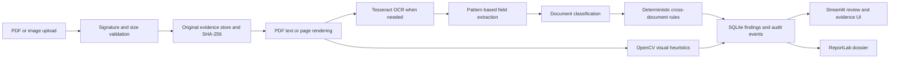

# Architecture

`core/analysis.py` contains stateless processing and comparison functions. `models/database.py` defines SQLite persistence. `app.py` orchestrates the workflow and Streamlit views. Original file bytes are saved unchanged; generated previews and report outputs are stored separately. No external LLM is invoked.
