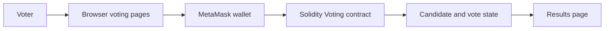

# Decentralized Voting System

**A static voting interface paired with a Solidity voting contract and MetaMask scripts.**

## Overview

This project contains browser pages for a decentralized voting prototype and a Solidity contract that stores three initial candidates, records votes, and limits each wallet address to one vote. The browser scripts use Web3.js and MetaMask for contract interaction.

## Key features

- Display the candidate list from the voting contract.
- Submit votes through a connected wallet.
- Store candidate vote totals and voter addresses on-chain.
- Show voting results in the result page.

## Tech stack

Solidity, HTML, CSS, JavaScript, Web3.js, and MetaMask.

## Architecture and workflow



## Project structure

```text
.
├── contracts/
│   ├── voting.sol
│   └── voting.json
├── html/       # Home, registration, login, dashboard, and results pages
├── js/         # Wallet, voting, authentication, and results scripts
└── css/        # Page styles
```

## Installation and execution

Serve the repository as static files from its root. For example, with Python:

```bash
python -m http.server 8000
```

Open [http://localhost:8000/html/index.html](http://localhost:8000/html/index.html) to view the pages.

To use wallet-backed voting, deploy `contracts/voting.sol` to an EVM-compatible network, then configure the deployed contract address and ABI for the client scripts. Connect MetaMask to the same network.

## Author

**Gireesh Sadanand Patgar** · [GitHub](https://github.com/gireeshpatgar17)